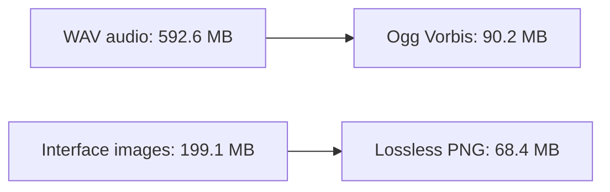

# Changes

This log records delivered changes and data-package updates. Client data is hosted separately on Drive; changing it does not automatically produce a new executable release.

## Unreleased gameplay fixes

- Reject skills locally when the known MP/SP budget is insufficient, with SysMsg 214 and the MP/SP label; recheck queued skills on reaching their target before sending or predicting animation.
- Remove floating labels from dropped items and route model clicks through pickup approach using the server's ten-unit range with a safety margin.
- Select the local player through the portrait or F2, with their name and current HP in the target frame.
- Announce friendly healing only after the recipient applies it; combat numbers reflect effective HP restored, and zero gain produces no number. Mob life drain also reports only actual HP gained.

## Unreleased documentation

- Visible screenshots at the top of the README and a full gallery.
- Contribution direction: original functional Shaiya foundation, Go and OpenGL 4.5, Linux as primary development platform and Windows support.
- Complete Linux/Windows portable client download on Drive, separate from executable-only GitHub release packages.
- Functional workflow status, supported-format tables and an explanation of the on-screen performance metrics.

## gx-v0.1.3 — November 13, 2026

- Publish native Linux and Windows client packages with checksums, notices and licenses alongside GX Server portables.
- Name client executables `Shaiya GX` and `Shaiya GX.exe`.
- Load loose `data/` beside the executable, independent of the working directory. SAH/SAF remain import formats rather than the game runtime layout.
- Decode Ogg Vorbis in Go at runtime. Convert the original 1,081 WAV resources to OGG during data preparation; converted audio uses libvorbis quality 6 at 44100 Hz. No external media codec is required to play.
- Convert 990 interface images from TGA/DDS/JPEG/BMP to lossless optimized PNG. Preserve alpha, distinct `_dds.png` atlases and authored mip levels in the optional `gxMP` PNG chunk. Other 3D textures keep their original formats.
- Convert seven CUR files to lossless PNG cursors and preserve their `(0,0)` hotspots.
- Embed Wine Tahoma and Open Sans; remove external font requirements.
- Retarget known sound references during import, with a guard against coincidental `.wav` bytes in binary geometry.

### Media conversion measurements

Historical conversion totals before later resource pruning. These compare the same source resources before and after conversion, not the current Drive archive size.

Audio reduction uses lossy Vorbis quality 6. PNG reduction preserves decoded pixels and authored mipmaps; it does not resize or quantize the interface.

### Separately distributed data updates

- Replace the active `Character/Skill.SData` using the author's `Skill4.SData`, identified by Parsec as EP6 and converted to EP5: 326 groups, nine slots per group, no active skills in discarded slots 10–15.
- Limit playable client maps to IDs 0–67 while retaining login and both factions' creation/selection scenes. Remove unsupported map resources and orphan Field/dungeon assets while preserving shared references.
- Remove unused models, textures, sounds, `holes.bin` and `Terrain/Brush` through conservative reference audits. The latest local audited data snapshot is 1,732,686,151 bytes (about 1.73 GB); the external Drive archive has not been independently hashed against that snapshot.
- These conversion counts describe migration history, not current file counts after pruning. Original resources and removal manifests remain in private backups outside the distribution.

## gx-v0.1.2 — November 13, 2026

- Integrate the former Rapture directly as GX Server in the root Go repository/module.
- Publish Windows/Linux server portables with GUI, console, login and world services.
- Distribute the explicitly requested development database with test accounts, characters and inventory, retaining compatibility environment keys and database filenames.
- Keep SQLite as an embedded development convenience, with a future backend replacement planned.

See [releases](https://github.com/Spelunkern/Shaiya-GX/releases), [progress](docs/progress.md) and [format details](docs/data-formats.md).
