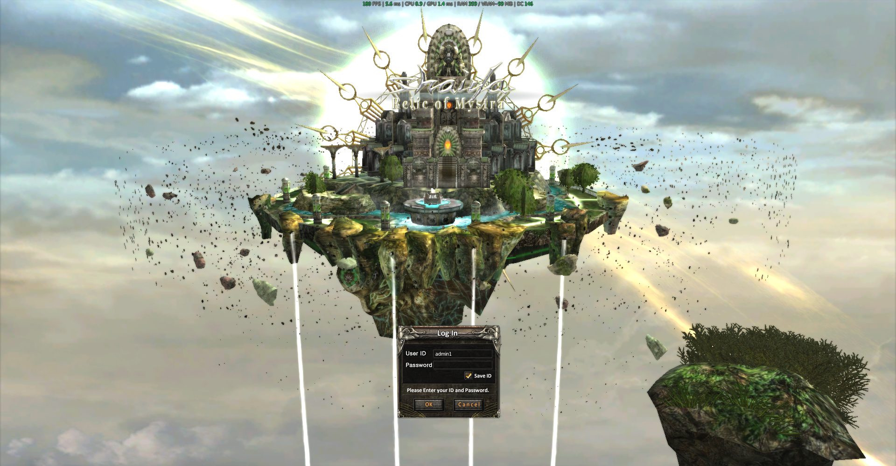
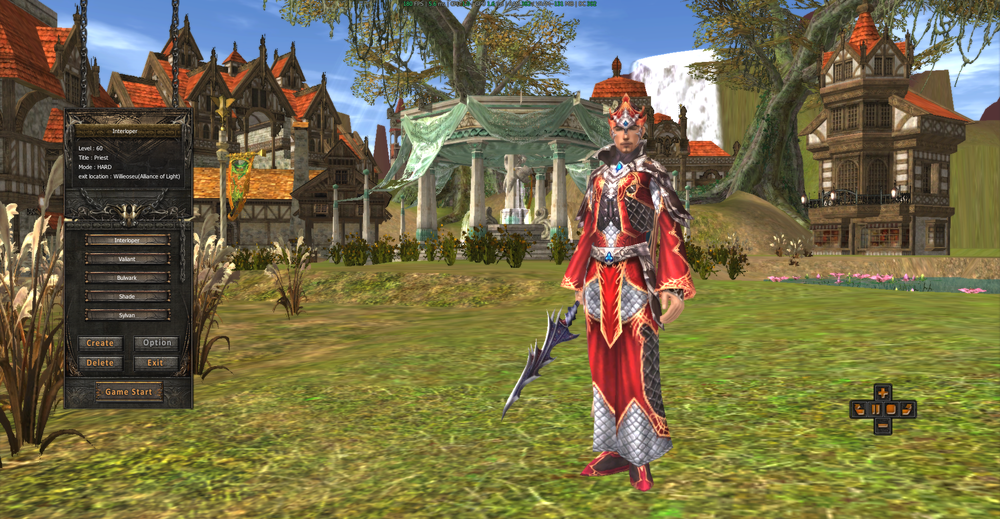
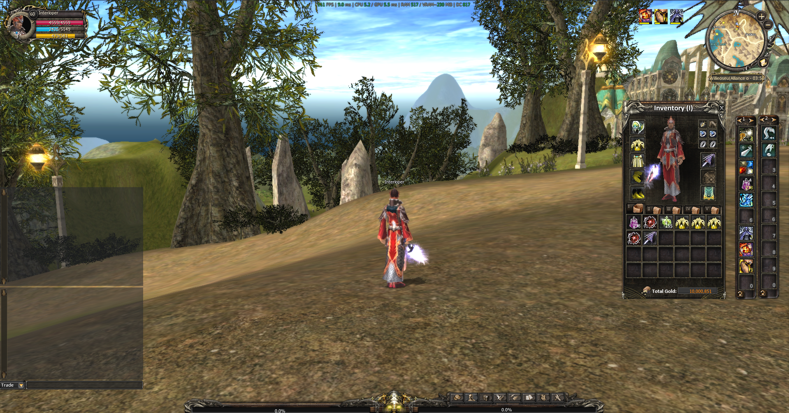

# Shaiya GX

Shaiya GX is a native 64-bit Shaiya EP5.4 client **and its integrated GX Server**, written in Go for Linux and Windows. The former Rapture server now lives in `server/`; there is one repository, one Go module and one place to build, contribute and report issues.

GX aims to build a functional foundation faithful to original Shaiya, rather than personal custom-server variants or unrelated graphical redesigns. Development is primarily on Linux; Go and OpenGL 4.5 remain the project's technical foundation, with Windows supported. Bug reports, refactors, missing original features, parity corrections, reverse engineering, measured optimizations and suggestions are welcome. Read [CONTRIBUTING.md](CONTRIBUTING.md) before proposing changes.

GX reads loose assets from a `data/` folder beside the **Shaiya GX** executable. Interface textures are PNG and sounds are Ogg Vorbis. Download the ready-to-use [portable client for Linux and Windows](https://drive.google.com/file/d/15BFHAGpLi_JJZbZ4fi8jpDsFQLdHmOyq/view?usp=sharing), or [import your existing archives](docs/data-formats.md). Client game data is distributed separately on Drive; it is not included in the source repository or GitHub executable-only packages. The client embeds Liberation Sans, a free Arial-metric-compatible face; UTF-8 text is supported within its glyph coverage. The Drive bundle is an older snapshot: update its executable using the latest GitHub release. The repository **does include server maps/configuration and the requested development database snapshot, including test accounts, characters and inventory**. It is test data, not a fresh production database.

**SQLite is used during development because an embedded database makes setup and distribution easy. It is temporary: the database backend will change in the future. The replacement and migration format are not selected yet.**

[**gx-v0.1.4 patch notes**](docs/releases/gx-v0.1.4.md) · [Latest client/server downloads](https://github.com/Spelunkern/Shaiya-GX/releases/latest)

## On-screen metrics panel

The small overlay at the top of the screenshots is a live performance diagnostic: **FPS**, average frame time, **CPU/GPU time**, resident **RAM**, estimated **VRAM** and **DC** (draw calls). CPU/GPU figures are milliseconds, not utilization percentages. Memory is displayed in MiB; `VRAM~` excludes driver overhead and the window-system framebuffer.

Values depend on the scene, hardware, resolution and frame limit; a screenshot is not a benchmark. [How to read the panel, colors and measurement limits](docs/performance.md).

## Project status

Snapshot: November 13, 2026. Counts come from the [server parity table](server/docs/original-parity.md); checklist entries differ in scope and are **not an overall project completion percentage**. Full client visual/gameplay parity remains in progress.

| Delivered | Current result |
|---|---|
| Portable clients | Native Linux and Windows builds; shared adjacent `data/`; embedded fonts |
| Media migration | OGG audio, PNG interface and seven PNG cursors |
| Integrated server | GX Server GUI/console, login/world and embedded development DB |
| Functional flows | Account entry, movement/combat, inventory/services and gatekeeper travel; scope and evidence in the progress guide |

| Data role | Accepted format |
|---|---|
| Interface and cursors | PNG |
| Audio | Ogg Vorbis (`.ogg`) |
| 3D textures | Original supported DDS/TGA/BMP/JPEG/PNG layouts |
| Models, worlds and effects | Original supported binary formats |
| Active skill catalog | EP5 `Character/Skill.SData` |
| Runtime storage | Loose `data/`; SAH/SAF for import only |

[Progress, delivered workflows and remaining work](docs/progress.md) · [Complete format matrix](docs/data-formats.md#supported-formats-by-role) · [Changes and migrations](CHANGELOG.md)

## Get started

1. Download `gx-server-windows-amd64.zip` or `gx-server-linux-amd64.tar.gz` from [GX releases](https://github.com/Spelunkern/Shaiya-GX/releases/latest), plus `SHA256SUMS.txt`. Extract the entire folder to a writable location. See [download verification](docs/quickstart.md#verify-a-download).
2. Open `build/gx_server.exe` on Windows or `build/gx_server` on Linux. The window is named **GX Server**. Click **Start server**. The terminal launcher `Start GX Server.bat` / `Start GX Server.sh` also works: type `start server` and later `shutdown server`.
3. Download the [portable client for Linux and Windows](https://drive.google.com/file/d/15BFHAGpLi_JJZbZ4fi8jpDsFQLdHmOyq/view?usp=sharing) and extract the complete folder. Open `Shaiya GX` on Linux or `Shaiya GX.exe` on Windows, keeping `data/` alongside both executables. Connect to `127.0.0.1:30800`. See the [portable client guide](docs/client-portable.md) for requirements and executable updates.
4. Log in with your test account. To create another, use the optional Python account tool described in the [first-run guide](docs/quickstart.md).

The portable server includes login, world, console, the one-button micro app, seed database, maps and configuration. Running its console or headless servers needs no Go, Docker, SQL Server, Python or external SQLite installation. The micro app also needs working desktop graphics libraries/drivers. Linux runtime packages and Windows build prerequisites are documented in [building](docs/building.md).

Closing the micro app or console leaves login/world running. Use **Stop server** or `shutdown server` before moving an installation or its database. [Operating and updating](docs/server.md) covers persistence, LAN connections, logs and backups.

## Status

This is a development project. Linux and Windows amd64 are supported build targets for client and server. CI builds and runs ordinary tests on both native operating systems and starts each native portable server in an isolated relocated folder. Client graphics/gameplay testing requires local assets and a real OpenGL 4.5 driver; CI compilation does not establish complete visual parity or compatibility with every GPU.

The client implements login, character creation/selection, world rendering, movement, combat, skills, inventory/equipment, NPC shops, loot, chat, party/raid, quests, trade, guilds, storage, blacksmith services, portals and social interfaces. Graphics include fog, water, actor shadows, effects and original UI artwork read from the data directory. Remaining limitations include visual/service variants, collision/navigation and some options. See [interface status](docs/interface.md).

GX Server retains Rapture's gameplay and protocol behavior. Its process names are now `gx_login`, `gx_world`, `gx_console` and `gx_server`; the advertised server name and micro app title are **GX Server**. Existing `RAPTURE_*` environment keys and `rapture.sqlite` filenames remain compatible to avoid changing operation or storage semantics.

## Guides

- [First run on Windows and Linux](docs/quickstart.md)
- [Build, test and package](docs/building.md)
- [Server operation, LAN, backup and updates](docs/server.md)
- [Architecture](docs/architecture.md), [protocol](docs/protocol.md), [interface status](docs/interface.md)
- [Server database](server/docs/sqlite.md), [distribution](server/docs/distribution.md), [gameplay parity](server/docs/original-parity.md)
- [Contributing](CONTRIBUTING.md) and [agent instructions](AGENTS.md)

## Common controls

| Input | Action |
|---|---|
| W/S, A/D, Q/E | Forward/back, turn, side step |
| Right mouse / both buttons | Steer / move forward |
| Wheel / F9 / F10 | Zoom / reset camera / first person |
| Space / C / Tab / NumLock | Jump / sit / walk or run / automatic movement |
| F2 | Select yourself |
| F / X / H | Attack target / stop attack / approach nearby loot |
| I / T / K / B | Inventory / Status / skills / actions |
| U / G / M / O | Quests / guild / map / options |
| Enter / Up / Down | Chat / sent-message history while typing |
| 1–9, 0 / numeric keypad | First / second action bar |
| Grave accent / Backspace | Cycle enemies / previous target |

Inventory: left-click uses an item, right-click equips/replaces it, drag moves it. Supported window headers and action bars are draggable. Escape closes the active panel first. Chat uses `!name message` for whisper, `@message` for party, `#message` for guild and `$message` for trade. Settings are kept in the user's configuration directory; passwords are not saved by the graphical client.

## Source layout and licenses

`cmd/`, `internal/` and `tools/` contain the client and its helpers. `server/cmd/`, `server/internal/`, `server/tools/` and `server/data/` contain GX Server and its distributed test fixtures. Build output, mutable databases, local overrides, logs and private analysis stay outside Git. Portable binaries are release assets, rather than source-history blobs.

Source is [BSD 3-Clause](LICENSE). The original server copyright and terms are retained in [server/LICENSE](server/LICENSE). Third-party notices are in [NOTICE](NOTICE). Original Shaiya game content and trademarks retain their respective ownership; the source license does not grant rights to game assets.

The complete [portable client for Linux and Windows](https://drive.google.com/file/d/15BFHAGpLi_JJZbZ4fi8jpDsFQLdHmOyq/view?usp=sharing) is hosted on Drive. Updated executable-only client builds are available in [GX releases](https://github.com/Spelunkern/Shaiya-GX/releases/latest); those archives do not include game data. Both executables may share one adjacent `data/` directory; see [portable client instructions](docs/client-portable.md).
