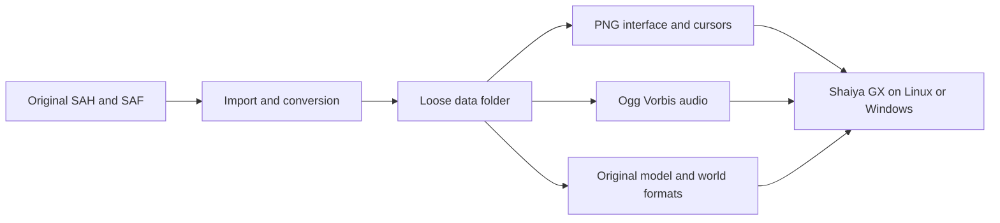

# GX data layout and media formats

The playable package is:

```text
Shaiya GX/
  Shaiya GX          # Linux; Shaiya GX.exe on Windows
  data/
    interface/       # PNG only, including icons, portraits and minimaps
    Sound/           # Ogg Vorbis, including Music/
    Character/
    World/
    ...
```

The executable discovers `data/` beside itself regardless of the current working directory. `-data` / `SHAIYA_DATA` can explicitly select a different data directory for development. No SAH/SAF index, launcher, Python or external media codec is needed to run the game. Fonts are external resources under `data/fonts/`; no system font installation is required. Platform graphics/audio libraries and drivers are still required.

GX indexes loose file paths once at startup and preserves the old case-insensitive resource lookup on Linux and Windows. Restart after editing assets to refresh that index and the CPU/GPU caches. Symlinks and ambiguous case/hash names are rejected, so the folder remains portable. A legacy invalid-byte filename is escaped as `%XX`; lookup applies the same mapping to binary references without changing model data.

## Supported formats by role

| Role | Formats | Current contract |
|---|---|---|
| Playable resource layout | Loose files under `data/` | Required by game startup; case-insensitive lookup on Linux/Windows |
| Legacy import | SAH + SAF | Parsec-compatible importer/tools only; not a playable GX package |
| Interface, icons, portraits and minimaps | PNG | PNG required under `interface/`; `_dds.png` distinguishes legacy DDS atlases; optional `gxMP` preserves authored mipmaps |
| Native cursor images | PNG | `Cursor/01.png`–`07.png`, original dimensions, hotspot `(0,0)` |
| Runtime audio | Ogg Vorbis (`.ogg`) | Mono/stereo decoded to 44100 Hz stereo PCM for mixing; WAV decoder is an import/verification utility |
| World/model/effect textures | DDS, TGA, BMP, JPEG and PNG | Existing content decoder; DDS supports DXT1/DXT3/DXT5 and supported uncompressed layouts; not arbitrary texture encodings |
| Character/creature resources | 3DC, ANI, MLT, ALT, MON, ITM | Skeletal meshes, animation clips and model/action tables in the supported original layouts |
| Cloaks | PC, CTL, 3DC | Original cloth resources; complete physics parity remains in progress |
| World resources | WLD, DG, SMOD, 3DO, MANI, VANI, WTR | Field/dungeon layouts, geometry, placed/animated objects and water definitions |
| Effect resources | EFT, 3DE, SEFF | Supported effect libraries, animated meshes and weapon-enchantment recipes |
| Gameplay tables | SData | Supported table-specific schemas; active `Character/Skill.SData` must be EP5 |
| Text and map configuration | `sysmsg-uni.txt`, existing map metadata | Read by their dedicated loaders; not a general document/config importer |
| Server maps | SVMAP | GX Server data, separate from client WLD/Field assets |

Format support means the layouts implemented by the corresponding [image](../internal/data/image), [model](../internal/data/model), [world](../internal/data/world), [effect](../internal/data/effect) and [SData](../internal/data/sdata) parsers. It does not imply every episode/version or every effect branch is implemented.



## Import original data

The original SAH is a directory/index and SAF contains file payloads. The importer follows the Parsec-compatible reader in `internal/data/archive`; it does not modify the source archives.

With FFmpeg/libvorbis, optipng, the client build dependencies and a working OpenGL context, run from the GX checkout:

```sh
go run ./cmd/datamigrate \
  -source /path/to/original-archives \
  -output /path/to/staging/data \
  -report /path/to/private/conversion.json
```

The output must be a new directory. The JSON report stays outside the playable data and records source/output paths, hashes, sizes, conversions and reference updates. `-resume` reuses verified successful results only when both original archive hashes and quality match the report. Keep source archives outside the playable folder for reference/re-import. Never commit those archives, the loose game data or the private conversion report.

Stage and verify the new directory and executable together before replacing an installation. Original clients cannot use this GX-specific layout without their own loader/media changes.

## Interface PNG

Every image under `interface/` is converted from its actual decoded content, including files whose old extension did not match their header. TGA, DDS, JPEG and BMP become real PNG files; this is not an extension-only rename. Conversion is lossless relative to the existing decoded pixels, including dimensions, alpha and RGB under fully transparent pixels. PNG uses best-compression deflate and lossless optipng optimization; no palette quantization or resizing is applied.

Some original TGA and DDS atlases share a stem while containing different artwork or layouts. DDS-origin files therefore use `_dds.png`, e.g. `icon/01_dds.png`, while the TGA counterpart becomes `icon/01.png`. Runtime references use these explicit PNG names.

For compressed DDS, the importer reads back the same GPU-decoded pixels as the existing renderer. Authored mip levels are preserved as additional lossless PNG images in an optional private ancillary `gxMP` chunk. Standard PNG viewers display the base image normally; GX restores all authored levels and their original sampling behavior. Editing the base image requires regenerating or dropping its old mip chunk to avoid stale levels. Textures for 3D characters, world geometry and effects retain their original formats and GPU compression.

## Ogg Vorbis audio

All WAV resources become `.ogg` using libvorbis VBR quality 6, 44100 Hz, retaining mono or stereo where applicable. Vorbis is lossy; this quality setting targets a substantial disk reduction while preserving high audio quality. Original sound durations are checked against the converted decoded PCM, and every result is decoded by GX's actual Go decoder before acceptance.

Audio references in structured MON/WLD and similar resources are retargeted from `.wav` to `.ogg` using equal-length substitutions, preserving record lengths and offsets. Hardcoded recipes, UI sounds, login music and tests also request OGG. Game audio decodes only Ogg Vorbis, without FFmpeg or codec DLLs at runtime; the bounded decoder normalizes supported mono/stereo streams to the existing 44100 Hz stereo PCM mixer. The old WAV decoder remains an import/verification utility.

This changes resource storage and loading, not server rules, packet formats, combat timing or database contents.


## Cursors and skill data

`Cursor/01.png` through `07.png` contain the native cursor artwork. Conversion preserves every decoded RGBA pixel and each cursor's dimensions; all seven original hotspots are `(0,0)`, used directly by the client. CUR is retained only as an import/test decoder.

The active skill catalog is `Character/Skill.SData`, encoded as EP5 (nine record slots per group). The author's replacement `Skill4.SData` was identified by Parsec as EP6, despite its filename; EP4 and EP5 readers reject that input. Parsec converted its 326 groups to EP5, retaining the first nine slots and group ordering. No active skills occupied slots 10–15. EP5 serialization was read back and verified byte-for-byte, with names, descriptions, icons and levels checked. The source and previous active catalog remain in private backups outside playable data; only the correctly named converted catalog is installed. This client catalog replacement does not migrate server skill definitions.


Map audio retains WLD point emitters and terrain walk-sound references. Music
fades with distance to each zone box; ambience uses spherical falloff, the
strongest emitter per asset and up to 24 audible ambient tracks. These mix rules
and gait-dependent footstep intervals follow Phoenix `scripts/map_audio.gd` and
`player_controller.gd`. OGG names resolve across `Sound/`, `Sound/back/` and
`Sound/Music/`, including legacy WAV references. Maps without authored music
zones retain their authored ambience. Music and Environment Sound settings control their
respective loops independently from combat/UI effects. Map decoding runs outside the render thread with at most two
jobs, while player creation and volume fades stay on the owner thread.


Outdoor ambience also retains the faction field bed explicitly listed in the
map's sound catalog (`bg_League of light_*` or `bg_Union of fury_*`). It plays
continuously on Environment Sound at the ambient base gain; local emitters add
their strongest in-range detail. This is a presentation adaptation: gating the
bed by its point placements left silent gaps, including the checked map 19
position. No music is invented for maps without authored music zones. Actual
ambient output has been captured from an isolated test sink with music and
effects muted, in addition to decoder/player-state checks.


WLD named areas retain their box, radius, both legacy strings, mode and trailing
word. Their position in the complete original record list is also the text ID:
mode-zero regions resolve it through the UTF-16 `world/<map>.txt` table. IDs are
sparse: mode-one/two records still occupy indices, and bitmap regions can occur
before later text labels. Do not compact text rows or derive IDs from the legacy
Korean caption. Mode-two captions are asset names resolved to PNG under
`interface/worldname/`.


The external font pack contains `fonts/ui.ttf`, `fonts/fonts.json` and unmodified
fallback faces/licenses under `fonts/unicode/`. The JSON coverage ranges allow
script faces to load only when a character requires them. The UI fonts share
parsed faces and rune resolution; shaped layouts and raster textures remain
bounded. The primary face is Wine's metric-compatible Tahoma. `SHAIYA_FONT` can
explicitly override the primary file while keeping the same external fallbacks.
`tools/prepare_fonts.py` indexes an existing primary/fallback source; fontTools is
an offline import dependency, never a game runtime dependency. Keep the primary
font's license beside `ui.ttf`. No font data is embedded in the game executable.
Emoji ZWJ, flag, skin-tone and keycap clusters use the colour-emoji face, with a
separate colour raster layer that preserves its pixels under chat tinting.

The native World Map uses `WorldMap.cfg`, `interface/wm_map.png`, `wm_letter.png`,
`wm_warning.png`, `wm_button_m.png`, `wm_button_w.png`, region overlays
`wm_e<MapNum>.png`, titles `wm_f<MapNum>.png`, and the existing full-map frame,
arrow and `MiniMap/<MapNum>.png` previews. CFG coordinates refer to its original
512×512 content area. Country 0/1/2 means both/Light/Fury. The legacy
`worldmap-light.jpg`/`worldmap-dark.jpg` images are not used by this EP5 path.
