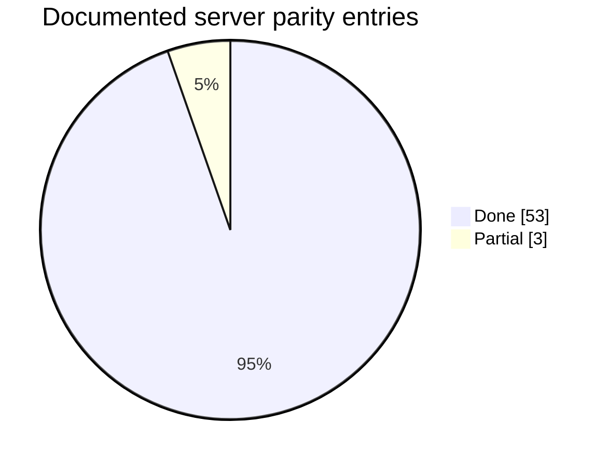
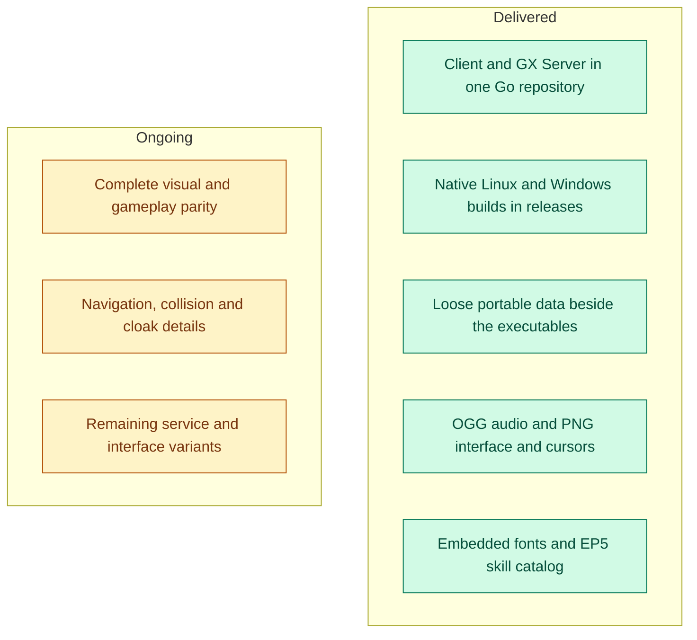

# Progress and delivered features

Updated November 13, 2026. This is a development snapshot, not a claim of complete original-game parity. **Delivered** means the named workflow is implemented and verified within its stated scope; remaining variants are tracked separately.

## Server parity checklist

The [original server parity table](../server/docs/original-parity.md) currently records **53 done and 3 partial entries**. These entries have different sizes and complexity; their counts are not an overall project completion percentage.

The chart summarizes the documented table, not an independent audit of every server rule. Keep the counts synchronized when that table changes.

## Delivery milestones

## Delivered functional workflows

| Workflow | Implemented scope | Evidence |
|---|---|---|
| Account entry | Login, server selection, faction confirmation, character creation/selection and entry into the world | [Account integration tests](../internal/app/integration_test.go), [N2 probe](../tools/n2_smoke.py) |
| Movement and combat input | Movement, target turning/approach, server-confirmed attacks and skill cooldowns | [Native control tests](../internal/app/native_controls_integration_test.go) |
| Skill presentation | Skill book and action bars, OGG cues, caster/target effects and area release synchronization | [Skill visuals](../internal/app/skill_visuals_integration_test.go), [area effects](../internal/app/area_effects_integration_test.go) |
| Inventory and services | Inventory/equipment, merchant purchases, warehouse transfers and blacksmith interactions | [Service status](interface.md), [warehouse tests](../internal/app/warehouse_integration_test.go) |
| Gatekeeper travel | NPC approach, destination selection, confirmation, fees, same-map/cross-map travel and saved position | [Gatekeeper tests](../internal/app/gatekeeper_integration_test.go) |
| Guild workflows | Creation, roster/ranks, notices, Etin and guild storage | [Guild creation](../internal/app/guild_create_integration_test.go), [bank tests](../internal/app/guild_bank_integration_test.go) |
| Portable client | Linux and Windows executables share adjacent data; fonts and Vorbis decoder embedded | [Portable guide](client-portable.md), [build workflow](../.github/workflows/ci.yml) |
| Portable GX Server | GUI and console control login/world; development seed creates a separate mutable runtime | [Distribution guide](../server/docs/distribution.md), [native package verification](../server/tools/package.py) |

Chat, party/raid, quests, trade/duels, social windows and the mall are also implemented; their remaining states and presentation gaps are detailed in [interface status](interface.md). A delivered workflow does not mark every feature variant complete.

## Remaining work

| Area | Remaining scope |
|---|---|
| Original parity | Full visual comparisons and rare gameplay/service states |
| Navigation | Complete collision/navigation behavior and remaining actions |
| Cloaks | Body/ground contact, map wind and guild emblem overlay |
| Interface | Quest tracker/markers, speech bubbles, remaining target indicators and service windows |
| Options | Resolution selection, shortcut editing and remaining controls |
| Server rules | Three partial entries in the [parity table](../server/docs/original-parity.md) |
| Persistence | Replace SQLite in the future; replacement engine and migration schedule are not selected |

## Validation boundaries

Native Linux and Windows CI builds and ordinary tests run without private game assets. Server integration, relocated startup and controller isolation are tested natively. Local graphics and N2 tests exercise compatible real data; Windows client graphics have additionally been checked under Wine. CI success is not full gameplay validation on every GPU or native Windows desktop.

Linux remains the primary development platform. Go and OpenGL 4.5 remain fixed project choices. See [contribution direction](../CONTRIBUTING.md), [supported formats](data-formats.md) and [changes](../CHANGELOG.md).
